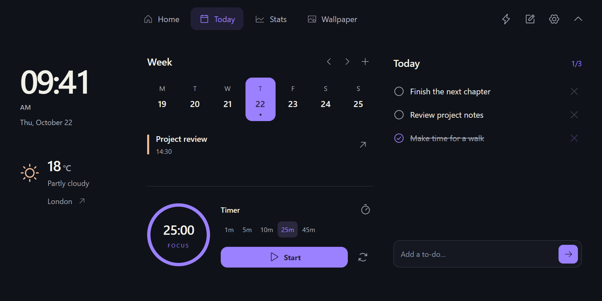

<p align="center">
  
</p>

<p align="center">
  <strong>Your Windows essentials. Within reach.</strong>
</p>

<p align="center">
  <a href="https://github.com/yzgershon/Yuta/actions/workflows/ci.yml"></a>
  
  
  <a href="LICENSE"></a>
</p>

<p align="center">
  <a href="#a-home-for-the-things-you-repeat">Explore</a> ·
  <a href="docs/BUILDING.md">Build</a> ·
  <a href="docs/USAGE.md">User guide</a> ·
  <a href="docs/PRIVACY.md">Privacy</a> ·
  <a href="https://github.com/yzgershon/Yuta/issues">Feedback</a>
</p>

Yuta brings music, copied items, app shortcuts, and everyday tools into a small notch at the top of your Windows desktop. Rest your pointer over it, click it, or press **Alt + Space**. Move away and it tucks back into the screen edge.

This is an early public source preview, developed on Windows 11. The repository contains the app and its tests; there is no signed installer or automatic updater yet. The source is public for review with **all rights reserved**. See [LICENSE](LICENSE).

## A Home for the things you repeat


Home keeps the frequently used controls together. Search across captured clipboard items, copy a result, open an app, or control the current track. Wi-Fi, Bluetooth, audio settings, and power actions stay within reach without filling the menu with oversized cards.

| Tool | What it does |
| --- | --- |
| **Music** | Artwork, track and artist, playback controls, and seeking through the active Windows media session. Spotify and other compatible players work without a separate account connection. |
| **Clipboard** | Opt-in text, link, and image history with search, pins, previews, copying, and pasting. History is encrypted for your Windows account. |
| **Apps** | Installed apps, files, folders, websites, favorites, and reusable text snippets. **Ctrl + K** opens the full launcher. |
| **Quick controls** | Small Wi-Fi, Bluetooth, and audio settings shortcuts, plus direct lock, sleep, restart, and shut-down actions. |

## Small when you need space


The idle notch shows the time, a running timer, or music with cover art and animated playback bars. Charging and audio-output changes briefly appear as status notices.

- **Deliberate opening.** A 450 ms hover with settled pointer movement avoids opening on a quick pass. Click and the configurable keyboard shortcut open immediately.
- **Smart flattening.** When supported Windows accessibility controls overlap the idle notch, it contracts into a plain black, four-logical-pixel strip. Detection uses control geometry, not screenshots or a vision model.
- **Your preferences.** Choose an attached notch or floating pill, a display, and one of six accents. Violet is the default.
- **Visibility control.** Right-click to hide Yuta for an app or a detected website, or pause it for one hour. Resume from the tray.

Accessibility-provider support varies by app. Smart flattening is experimental and can be turned off in Settings.

## A place for the rest of your day



**Today** holds the clock, city-based weather, local calendar, tasks, and focus timer. **Stats** shows system activity and top processes. **Wallpaper** browses a local image folder. Routines open a saved group of destinations, and Quick note keeps an automatically saved scratchpad.

Calendar events are local. Calendar-account sync, general Bluetooth device batteries, calls, and hotspot activity are not implemented. The [user guide](docs/USAGE.md) covers current behavior and shortcuts.

## Build on Windows

Install the [.NET 8 SDK](https://dotnet.microsoft.com/download/dotnet/8.0) and the [WebView2 Evergreen Runtime](https://developer.microsoft.com/microsoft-edge/webview2/). Use Node.js 24 and Microsoft Edge for browser tests.

```powershell
git clone https://github.com/yzgershon/Yuta.git
cd Yuta

# Intel / AMD Windows
.\scripts\build.ps1 -Runtime win-x64

# Windows on ARM
.\scripts\build.ps1 -Runtime win-arm64
```

Run `Yuta.exe` from the matching `release\yuta\<runtime>\` directory. Keep the entire directory together. The portable build includes .NET; it still needs WebView2. Yuta does not add itself to startup.

For prerequisites, test commands, browser preview, and troubleshooting, see [Building and testing](docs/BUILDING.md).

## Local data, explicit integrations

Notes, tasks, settings, and routines stay in a local profile. Clipboard recording starts off. Weather requests go to Open-Meteo only when a city is configured; the optional speed test contacts Cloudflare. Yuta has no account service or analytics backend.

Read the [privacy and storage guide](docs/PRIVACY.md) for exact paths, encryption boundaries, browser-host detection, and network behavior.

## Project notes

- [Architecture](docs/ARCHITECTURE.md) — Windows host, local UI, bridge, and native idle surface.
- [Contributing](CONTRIBUTING.md) — feedback, proposed changes, and verification expectations.
- [Security](SECURITY.md) — private vulnerability reporting.
- [Changelog](CHANGELOG.md) — current public preview scope.
- [Media](docs/MEDIA.md) — artwork provenance and reproducible screenshot captures.
- [Third-party notices](THIRD_PARTY_NOTICES.md) — dependencies and attribution.

The two product photographs are AI-generated illustrations. Home and Today are captures of the actual UI with fictional sample content. Windows, Spotify, and other product names belong to their respective owners; Yuta is an independent project.
