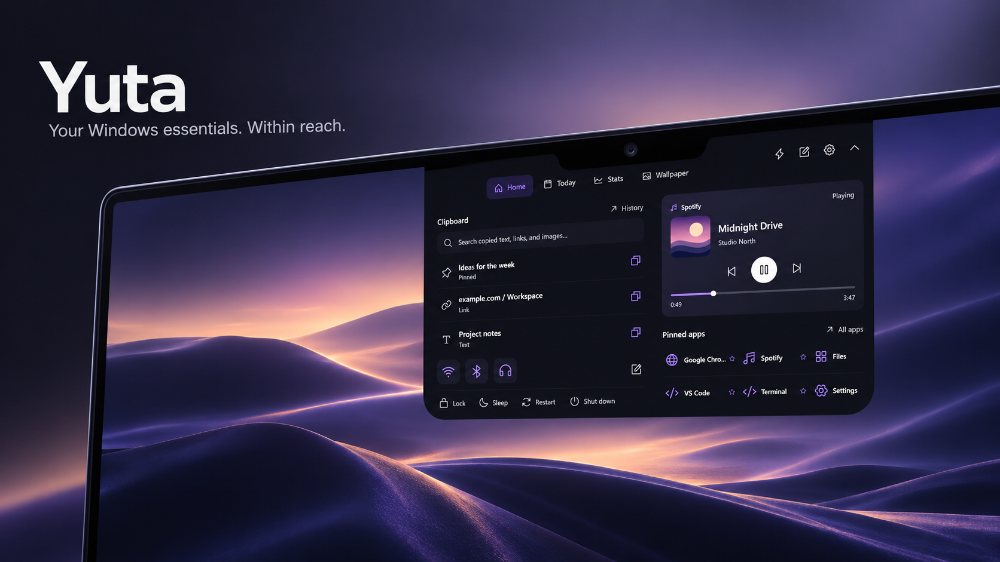
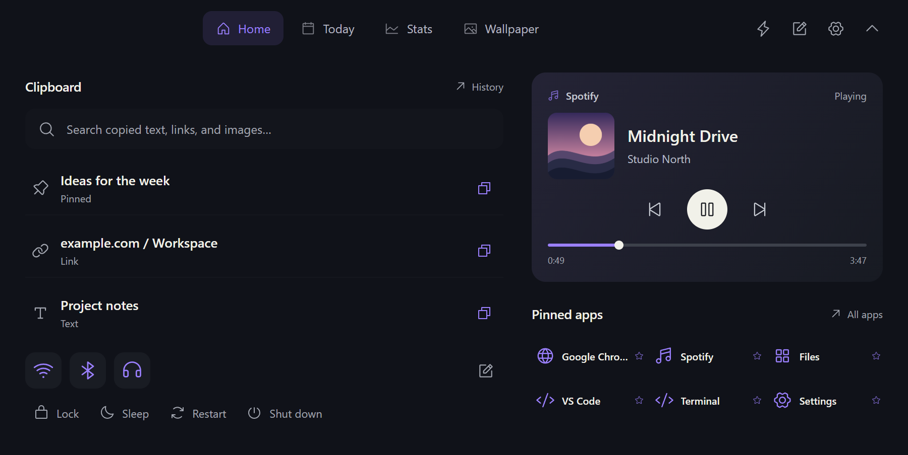
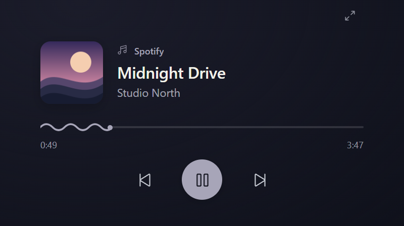
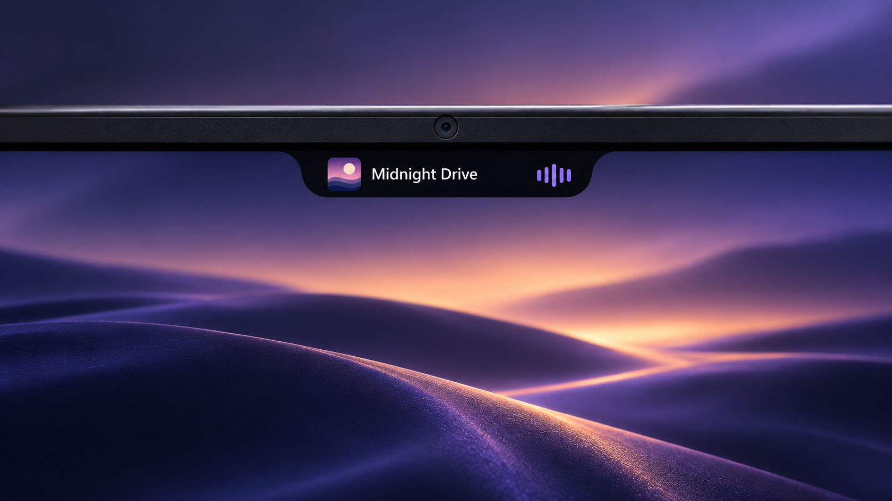
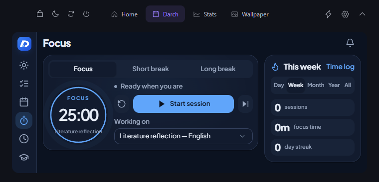

<p align="center">
  
</p>

<p align="center">
  <strong>Your Windows essentials. Within reach.</strong>
</p>

<p align="center">
  <a href="https://github.com/yzgershon/Yuta/actions/workflows/ci.yml"></a>
  
  
  <a href="LICENSE"></a>
</p>

<p align="center">
  <a href="#download">Download</a> ·
  <a href="#a-home-for-the-things-you-repeat">Explore</a> ·
  <a href="docs/BUILDING.md">Build</a> ·
  <a href="docs/USAGE.md">User guide</a> ·
  <a href="docs/PRIVACY.md">Privacy</a> ·
  <a href="https://github.com/yzgershon/Yuta/issues">Feedback</a>
</p>

Yuta brings music, copied items, app shortcuts, and everyday tools into a small notch at the top of your Windows desktop. Rest your pointer over it, click it, or press **Alt + Space**. Move away and it tucks back into the screen edge.

Yuta is available as a portable Windows 11 app for **x64 and ARM64**. The source is public for review with **all rights reserved**. See [LICENSE](LICENSE).

**Yuta 0.3.0** adds a shorter, 400 × 144 music player and the connected [Darch workspace](docs/darch.md), adapted to the notch with Darch's original interface and configurable sections. Connect your Darch account from Yuta Settings. See the [changelog](CHANGELOG.md) for details.

## Download

| Your computer | Yuta 0.3.0 |
| --- | --- |
| Intel / AMD Windows PC | **[Download for Windows x64](https://github.com/yzgershon/Yuta/releases/download/v0.3.0/Yuta-0.3.0-win-x64.zip)** |
| Snapdragon / Windows on ARM | **[Download for Windows ARM64](https://github.com/yzgershon/Yuta/releases/download/v0.3.0/Yuta-0.3.0-win-arm64.zip)** |

**Extract the ZIP, open the `Yuta` folder, and run `Yuta.exe`.** Keep the whole folder together. Check **Settings → System → About → System type** if you are unsure which download to choose.

.NET is included; [WebView2 Evergreen Runtime](https://developer.microsoft.com/en-us/microsoft-edge/webview2/#download-section) is required. The portable builds are unsigned and do not include an automatic updater. See the [installation and update guide](docs/INSTALL.md), [release notes](https://github.com/yzgershon/Yuta/releases/tag/v0.3.0), and [SHA-256 checksums](https://github.com/yzgershon/Yuta/releases/download/v0.3.0/SHA256SUMS.txt).

## A Home for the things you repeat



Home fits the essentials into a compact 760 × 366 logical-pixel frame. Blue Wi-Fi, Bluetooth, and audio switches sit beside a scrollable clipboard; the artwork-tinted player and pinned app icons share the right column. Power actions stay in the header, with centered navigation and no footer taking up space.

| Tool | What it does |
| --- | --- |
| **Music and video** | Artwork, track and artist, immediate playback feedback, and a curved seek line. The first opening shows a small player while media is playing; a second opens Home. Compatible Windows media sessions work without a Spotify login. |
| **Clipboard** | Opt-in text, link, and image history with real thumbnails, scrolling, direct paste, and hover-to-delete. History is encrypted for your Windows account. |
| **Pinned apps** | Launch from app icons. Use the pencil to choose your pins; **Ctrl + K** opens the pin editor. |
| **Quick controls** | Split Wi-Fi, Bluetooth, and audio buttons: toggle on the left, Windows settings on the right. Direct lock, sleep, restart, and shutdown sit in the header. |

<p align="center"></p>

## Small when you need space



The idle notch shows the time, a running timer, or music with cover art and thin purple-to-blue bars driven by local audio levels. Active microphone sessions can show voice activity. Charging and audio-output changes briefly appear as status notices.

- **Deliberate opening.** A 450 ms hover with settled pointer movement avoids opening on a quick pass. Click and the configurable keyboard shortcut also open Yuta. The contour opens smoothly over 480 ms without scaling the text.
- **Smart flattening.** When supported Windows accessibility controls overlap the idle notch, it contracts into a plain black, four-logical-pixel strip. Detection uses control geometry, not screenshots or a vision model.
- **Your preferences.** Choose an attached notch or floating pill, a display, and an accent. Violet navigation, blue connection controls, and artwork-based media colors give each function a clear identity.
- **Visibility control.** Right-click to hide Yuta for an app or a detected website, or pause it for one hour. Resume from the tray.

Accessibility-provider support varies by app. Smart flattening is experimental and can be turned off in Settings.

## A place for the rest of your day



**Darch** brings Today, Assignments, Calendar, Focus, Time log, Grades, Brain games, and Settings into Yuta, plus SAT and Admin when the connected account permits them. Its original fonts, themes, and components fit the compact frame. Hide or reorder sections in Yuta Settings. Sign in through Chrome, edit the same Darch account data, and keep Focus synced between Darch and Yuta. Existing local tasks remain in the profile.

**Stats** shows system activity and top processes. **Wallpaper** browses a local image folder. Routines open a saved group of destinations. Every full-menu view uses the same compact frame, with longer content scrolling inside it.

Darch calendar changes sync through your Darch account; direct Google or Outlook calendar integration is not included. General Bluetooth device batteries and hotspot activity are not implemented. Voice activity uses Windows microphone/session meters; it is not a universal call-status detector. Browser calls are identified by browser, not by the individual meeting tab. The [user guide](docs/USAGE.md) covers current behavior and limits.

## Build on Windows

Install the [.NET 8 SDK](https://dotnet.microsoft.com/download/dotnet/8.0) and the [WebView2 Evergreen Runtime](https://developer.microsoft.com/microsoft-edge/webview2/). Use Node.js 24 and Microsoft Edge for browser tests.

```powershell
git clone https://github.com/yzgershon/Yuta.git
cd Yuta

# Intel / AMD Windows
.\scripts\build.ps1 -Runtime win-x64

# Windows on ARM
.\scripts\build.ps1 -Runtime win-arm64
```

Run `Yuta.exe` from the matching `release\yuta\<runtime>\` directory. Keep the entire directory together. The portable build includes .NET; it still needs WebView2. Yuta does not add itself to startup.

For prerequisites, test commands, browser preview, and troubleshooting, see [Building and testing](docs/BUILDING.md).

## Local data, explicit integrations

Yuta preferences and routines stay in a local profile. Connecting Darch is optional; its workspace reads and writes your Darch account through that service. Credentials are protected by Windows DPAPI and the connection can be revoked. Clipboard recording starts off. Audio activity reads Windows level meters without opening a recording stream or storing audio. Weather requests go to Open-Meteo only when a city is configured; the optional speed test contacts Cloudflare. Yuta has no separate account service or analytics backend.

Read the [privacy and storage guide](docs/PRIVACY.md) for exact paths, encryption boundaries, browser-host detection, and network behavior.

## Project notes

- [Architecture](docs/ARCHITECTURE.md) — Windows host, local UI, bridge, and native idle surface.
- [Contributing](CONTRIBUTING.md) — feedback, proposed changes, and verification expectations.
- [Security](SECURITY.md) — private vulnerability reporting.
- [Changelog](CHANGELOG.md) — current public preview scope.
- [Media](docs/MEDIA.md) — artwork provenance and reproducible screenshot captures.
- [Third-party notices](THIRD_PARTY_NOTICES.md) — dependencies and attribution.

The two product photographs are AI-generated concept illustrations from the initial preview. Home, Today, and the compact player are captures of the current UI with fictional sample content. Windows, Spotify, and other product names belong to their respective owners; Yuta is an independent project.
