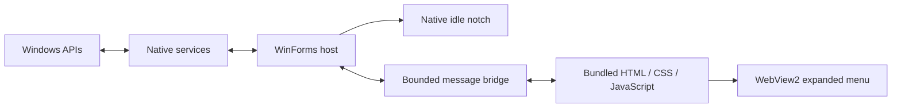

# Architecture

Yuta combines a native Windows idle surface with a local HTML menu. The native surface keeps the collapsed notch responsive without requiring an always-animating browser view.

| Area | Entry points |
| --- | --- |
| Startup and single instance | `Program.cs` |
| Window lifecycle, bridge, placement, and transitions | `NotchForm.cs` and partial files |
| Idle clock, timer, music, and notices | `IdleNotchWindow.cs`, `IdleNotchWindow.Activity.cs` |
| Outline and hit area | `NotchGeometry.cs` |
| Hover and retraction policies | `HoverIntent.cs`, `HoverRetraction.cs` |
| Settings, clipboard, media, launcher, statistics, wallpapers, and visibility | `Services/` |
| Navigation, retained DOM, and interaction state | `ui/app.js` |
| Home composition | `ui/home.js`, `ui/home.css` |
| Media rendering and optimistic transport state | `ui/media.js`, media handlers in `ui/app.js` |
| Compact media view, artwork palette, and shared panel frame | `ui/media.css`, `ui/media-palette.js`, `ui/panels.css` |
| Local audio-level sampling and amplitude envelope | `Services/AudioLevelService.cs`, `Services/AudioEnvelope.cs` |
| Native/demo protocol adapters | `ui/bridge.js` |

## Interaction design

The browser viewport stays fixed during opening and closing. Native clipping animates the visible bounds, avoiding repeated responsive layout work on every frame. Rapid reversals continue from the current geometry. The native idle surface uses display-density-aware rendering and transparent antialiased edges.

Full views share a 760 × 366 logical-pixel frame; the media-only view is 400 × 224. A generation-based layout-ready handshake prevents the host from revealing a stale intermediate viewport. Opening takes 480 ms and closing takes 260 ms; content fades/translates without a scale transform. `NotchGeometry.cs` and `ui/notch-path.js` share the extended shoulder shape for native and browser surfaces.

Expanded panels are retained and patched instead of rebuilt wholesale. Keys preserve focused fields, selection, drafts, scroll positions, and decoded images. Hardware reads do not block navigation. Media transport has immediate optimistic feedback, ordered commands, and rollback when the player rejects an action.

On collapse, section polling stops. The WebView remains warm briefly, then suspends until needed. Waveform animation stops when hidden or flattened and respects reduced motion.

## Integration boundaries

The host validates commands from the local UI and blocks external WebView navigation. Launcher targets are bounded to files, folders, applications, and HTTP(S) destinations; a routine is not a shell-script runner.

Smart flattening is a geometry policy over Windows accessibility observations. Website exclusions are a separate address-bar hostname mechanism. These features have different data boundaries and should remain separate when changed.

The browser preview uses a demo adapter, while documentation and browser tests supply synthetic bridge responses. Preview success does not establish that a native integration works on a particular device. Keep test results explicit about that distinction.
